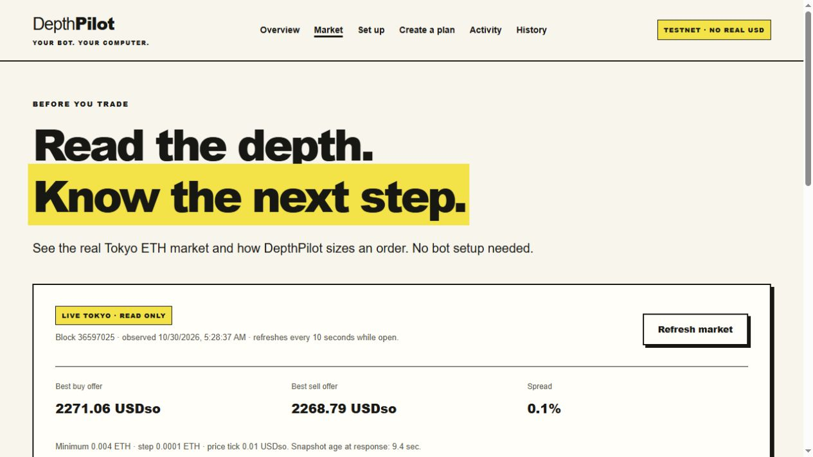
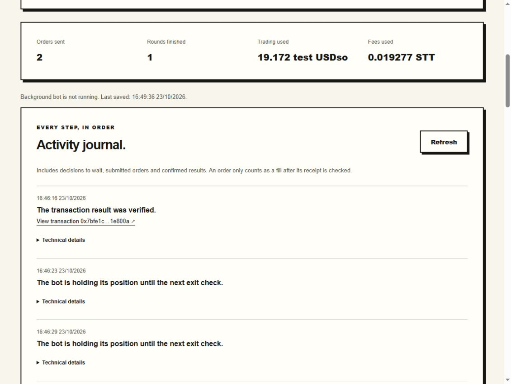

# DepthPilot

> **Version 0.3.2:** understand saved decisions, check interruptions without resending, and export a standalone HTML receipt report. The Windows ZIP below is the exact locally tested package. Its embedded documentation and source ZIP are pre-publication snapshots; use this README for current download/install links.

> **Version 0.3.0:** explore live market depth, understand the next order, revisit saved-session reports and reuse settings. Stop/reconcile and close an existing DepthPilot app before updating. Your profile stays in place; installing does not start a trading plan.

**A local dreamDEX trading bot. You choose the rules; your dashboard explains every decision.**

DepthPilot runs on your Windows PC and trades **ETH perpetuals on Tokyo testnet** through the official dreamDEX SDK. Create a separate local bot, link its public address on dreamDEX, choose a plan, review the limits, and follow its activity in your browser.

**Start here:** [Watch the reference operator](https://duclucky.github.io/depthpilot/) · [Download Windows 0.3.2](https://github.com/duclucky/depthpilot/releases/download/v0.3.2/DepthPilot-0.3.2-windows-x64.zip) · [Release and checksums](https://github.com/duclucky/depthpilot/releases/tag/v0.3.2) · [Official Link a Bot guide](https://app.dreamdex.io/docs/trading/common/link-a-bot)

You do not paste your main wallet's private key or connect its extension to DepthPilot. Your main wallet stays on dreamDEX. DepthPilot creates a different signing key on your PC, protected by Windows, and uses the trading access you explicitly grant it.



[Watch the 84-second 0.3.1 walkthrough](docs/demo-0.3.1.mp4): actual UI captures labelled as real Tokyo read-only data, synthetic setup with trading disabled, and historical 0.2.2 receipts. It is an edited captioned walkthrough, not a new live trading run.

## Contents

1. [What the bot does](#1-what-the-bot-does)
2. [What you need](#2-what-you-need)
3. [Install on Windows](#3-install-on-windows)
4. [Understand the two addresses](#4-understand-the-two-addresses)
5. [Create and link your bot](#5-create-and-link-your-bot)
6. [Give the bot gas on the correct network](#6-give-the-bot-gas-on-the-correct-network)
7. [Check your trading account](#7-check-your-trading-account)
8. [Run a small first plan](#8-run-a-small-first-plan)
9. [Read activity and stop](#9-read-activity-and-stop)
10. [Reopen, restart and update](#10-reopen-restart-and-update)
11. [Troubleshooting](#11-troubleshooting)
12. [What was verified](#12-what-was-verified)
13. [Limits and key protection](#13-limits-and-key-protection)
14. [For developers](#14-for-developers)

## 0.3.2: understand, check and review

In **Activity**, **Why this step?** explains the latest saved decision. It shows recorded values beside your rules, the age of the market observation separately from the last state save, remaining fee reservations and the earliest eligible check when known. Waiting time comes from a bounded tail of saved decisions; if the start is outside that window, it is labelled **at least**. This is evidence of recorded decisions, not proof of uninterrupted uptime or a promise of a fill.

Choose **Check current state** when something needs review. It reads Tokyo account permissions, position, open orders, equity, bot gas and confirmed/pending transaction counts. For a saved pending intent, it attempts to verify the exact transaction receipt against the saved call and nonce. Missing receipts, unverifiable intent, changed exposure, network failure and missing local permission remain explicit. The screen never signs, resends, restores authority or restarts a plan. Reads time out rather than leaving the check waiting indefinitely; separately sampled results can still change afterward.

In **History**, **Save HTML report** creates a static page you can open directly in a browser, even offline. It includes confirmed fills, recorded gas, reviewed limits and public transaction links. Missing gas, unresolved orders, partial fills and resulting exposure remain visible. Account addresses, keys, calldata and trading authority are excluded, but public hashes can reveal accounts on an explorer. This exported record is not independent fresh chain verification or PnL. **Export Markdown** and **Export settings** remain available.

This increment changes observation and report workflows. It introduces no trading strategy, resume action, dependency or Reactivity connection. Keep the existing distinction between stopped local authority and the separate Link a Bot grant on dreamDEX.

## Local 0.3.1 safety update

- **Closing a remainder:** after a partial fill, the bot retains its actual remaining quantity. A lot-aligned amount below the normal order minimum can be attempted only as an exact opposing close of the observed owned position, within the same price, depth participation and SDK capacity bounds. A changed position or open orders block signing. Off-step positions and insufficient depth still require attention; no rounding up or guaranteed exit. Ordinary target orders retain the market minimum.
- **Gas headroom:** SDK order construction and estimation support at most 30 million gas. The chosen gas limit remains bounded by estimates, fee budgets, native reserve and closing reserve. Larger technical headroom does not increase the STT budget. Target plans also preserve the 1 STT native reserve before a send.
- **Review before running:** new round plans reserve up to three closing order slots before opening. Their cumulative order ceiling is shown explicitly and stays at or below 600. The closing fee reserve is half the selected fee budget, capped at 0.3 STT, inside that budget; the untouched 1 STT remains separate. Setup/review checks whether the bot actually has enough for these reserves. Existing plans do not inherit new authority.
- **Installer clarity:** the candidate Windows ZIP contains the local launcher/installer and its own manifest, without the separate GitHub bootstrap or stable-release checksum file. The source snapshot retains those stable references so their tests can run. Stop/reconcile and close an older app before installing a different version.

A fresh Tokyo read-only contract simulation accepted an exact full residual close and rejected partial/increasing/off-step controls. Deterministic regressions exercise partial-close reconciliation and the new gas/reserve gates. These checks do not establish a new 0.3.1 live trade. Historical onchain evidence below remains attributed to 0.2.2.

## New in 0.3.0

### See the market before setting up a bot

Open **Market** to read ETH-PERP depth on Tokyo through the Markets SDK and a block-pinned order book. It shows best offers, spread, market minimum/step and freshness. No key or account is needed. Enter a total amount and per-order limit, then choose **Preview the next order**. The same integer planner used by the execution bot applies the price bound, spread, minimum/step and 25% depth participation rules.

A successful preview shows the estimated next child, average price and sizing constraint. A blocked preview explains the wait. It is one snapshot, not a backtest, fill promise, capacity check or trading recommendation. **Use these inputs in a plan** copies inputs only; choose budgets, finish account setup and review before anything can trade. RPC errors mark the market unavailable; stale blocks do not become fresh merely because a response arrived recently.

### Learn from saved sessions

Open **History** to revisit past plans, including compatible 0.2.2 history. Reports show confirmed buy/sell volume and average prices, fill rate, actual recorded gas, outstanding fee reservations, pending hashes and receipt links. Target plans also show completion and signed arrival slippage; positive means worse than the arrival reference. Gas and funding are separate, and these measures are **not PnL**. Missing gas is marked incomplete. Unconfirmed or reverted orders never become successful fills.

The saved journal is paginated and remains attached to its original session. **Export report** downloads a readable Markdown report without wallet addresses, keys, calldata or authority. Public transaction links can still reveal accounts on an explorer. A report is a saved record, not a new onchain check or proof that a stopped account is flat.

### Reuse settings, never permission

In **Create a plan**, choose **One small round** as an editable test starting point, or **Save settings / Load settings** to reuse a small JSON settings file. History offers **Use this plan again** and **Export settings**. Settings contain only validated Tokyo plan inputs. They exclude identities, absolute deadlines, keys, recovery opt-in and trading authority. Imports reject unexpected fields and unsupported versions. Every reuse becomes an unapproved draft requiring a fresh account/market review and explicit confirmation.

Version 0.3.0 retains the extension-free Link a Bot setup and the hidden Windows launcher. It adds no dependencies, changes no signing/reconciliation logic, starts no plan on installation, and includes no author's profile/history. The original 0.2.2 live evidence below remains historical evidence; it is not a new 0.3.0 live trading test.

## Public reference dashboard

[Watch the reference operator](https://duclucky.github.io/depthpilot/) before downloading. The public site is a read-only product page and periodically refreshed bot snapshot; it cannot connect a wallet, sign, start or stop trading. It shows actual recorded receipts, decision reasons, exposure and cumulative limits from a separate Tokyo reference deployment. This is not a new run of the 0.3.2 installer, a PnL leaderboard or proof of uninterrupted 24-hour uptime.

The reference operator can remain online while new entries are paused by its original equity or quota rules. A lack of new orders is shown as a pause, not hidden or converted into simulated activity. Publishing occurs about every five minutes through the public `telemetry` branch; raw-file caches can add delay. The page shows the observation and publication times and marks stale/unavailable snapshots.

Only allowlisted public summary fields and receipt links are exported. No primary/operator key, calldata, signed transaction, trading authority, local path or control endpoint is published. The local publisher uses the operator host's existing Git authentication; that credential is never sent to the website. Source for the projection/publisher is in `monitor/`; it reads the legacy reference monitor format, not arbitrary installer profiles. Public snapshots retain at most 60 recent decisions and the bounded run's transaction list; the full local journal stays local.

## 1. What the bot does

| Plan | What happens | What remains afterward |
| --- | --- | --- |
| **Buy ETH, then close — repeat in rounds** | The bot buys a small position, waits until its holding time has passed, attempts to close, then waits before another round. | A completed round is flat. A failed exit can leave exposure needing attention. |
| **Buy/sell a total amount in smaller orders** | The bot works toward one target using smaller orders within your price and time limits. | The resulting position remains in the trading account. This mode does not automatically reverse it. |

Before an order, the bot checks market freshness, spread, visible liquidity, the account, permissions and remaining budgets. It uses at most 25% of visible depth, waits when rules are not met, verifies receipts before counting fills, and keeps a journal.

This is a deterministic execution tool, not a price predictor. Round trips support bounded testnet experiments; one successful test does not establish a profitable strategy. Tokyo balances and paper USDso in this release are test assets.

## 2. What you need

| Requirement | Why it is needed |
| --- | --- |
| **64-bit Windows** with Windows Script Host available | The package bundles Node and uses a hidden Windows launcher. macOS/Linux installers are not included. |
| Internet access and a browser | The bot uses dreamDEX markets and transactions; the browser shows your local dashboard. |
| A dreamDEX testnet **Somnia Account** | Link a Bot uses a Somnia Account. A login EOA or Legacy Account is not interchangeable with it. |
| Healthy Perps margin in that account | This supplies collateral. Readiness requires at least 1.5 test USDso and no existing position/open orders. |
| Test STT at the **bot address on Tokyo** | The bot pays its own fees. Setup requires at least 1.12 STT; 1 STT stays in reserve. |
| A PC that stays on and awake | The bot runs on your computer. Sleep, shutdown and lost connectivity interrupt it. |

You do **not** need administrator access, a system Node/npm installation, a cloud server, a paid API key or GitHub login to use the Windows release. Installing does not automatically link a wallet, bridge funds or start trading.

## 3. Install on Windows

Choose **one** method. Both use the same tested 0.3.2 Windows package. For an update, stop/reconcile your current plan and use **Close local app** first.

### Option A — download and double-click

1. Download [DepthPilot-0.3.2-windows-x64.zip](https://github.com/duclucky/depthpilot/releases/download/v0.3.2/DepthPilot-0.3.2-windows-x64.zip). Choose this Windows asset, not GitHub's automatic “Source code” download.
2. Extract the **whole folder** into a location you control. Do not run a file from inside the ZIP.
3. Open the extracted `DepthPilot-0.3.2` folder.
4. Double-click **Open DepthPilot.bat**.
5. Your browser opens the local dashboard automatically. A batch window may flash briefly; no terminal needs to remain open for the application.

This portable option needs the extracted folder for future launches. Your profile lives in a separate data directory. For Desktop/Start Menu shortcuts and a persistent installation, use Option B or run the extracted package's `install.ps1`. If PowerShell scripts are restricted, Option A works without changing that policy.

### Option B — paste into PowerShell

Open **ordinary PowerShell as your normal Windows user**, copy this whole block, and press Enter. It downloads the fixed release, checks SHA-256, installs with its bundled runtime and opens the dashboard. Once the dashboard opens, you can close PowerShell.

```powershell
& {
    $ErrorActionPreference = 'Stop'
    $DepthPilotURL = 'https://github.com/duclucky/depthpilot/releases/download/v0.3.2/DepthPilot-0.3.2-windows-x64.zip'
    $DepthPilotSHA256 = 'e3f4d2a282705cccf91a50dc7132700c00e2ea44e93623cc36bb11e8bfcc1934'
    $DepthPilotFolder = Join-Path $env:LOCALAPPDATA ('DepthPilot\downloads\0.3.2-' + [Guid]::NewGuid().ToString('N'))
    New-Item -ItemType Directory -Path $DepthPilotFolder | Out-Null
    $DepthPilotZIP = Join-Path $DepthPilotFolder 'DepthPilot.zip'
    Write-Host 'Downloading and checking DepthPilot 0.3.2...'
    Invoke-WebRequest -UseBasicParsing -Uri $DepthPilotURL -OutFile $DepthPilotZIP
    $DepthPilotStream = [IO.File]::OpenRead($DepthPilotZIP)
    $DepthPilotHasher = [Security.Cryptography.SHA256]::Create()
    try { $DepthPilotActual = [BitConverter]::ToString($DepthPilotHasher.ComputeHash($DepthPilotStream)).Replace('-', '').ToLowerInvariant() }
    finally { $DepthPilotStream.Dispose(); $DepthPilotHasher.Dispose() }
    if ($DepthPilotActual -ne $DepthPilotSHA256) { throw 'SHA-256 check failed. Nothing was installed.' }
    Add-Type -AssemblyName System.IO.Compression.FileSystem
    [IO.Compression.ZipFile]::ExtractToDirectory($DepthPilotZIP, $DepthPilotFolder)
    $DepthPilotApp = Join-Path $DepthPilotFolder 'DepthPilot-0.3.2'
    & (Join-Path $DepthPilotApp 'runtime\node.exe') (Join-Path $DepthPilotApp 'scripts\install.mjs')
    if ($LASTEXITCODE -ne 0) { throw 'Installation did not finish. Stop and close an existing DepthPilot app before trying again.' }
}
```

The block runs the verified ZIP's installer. It does not download/evaluate a remote PowerShell script or change execution policy. An equivalent [Install-DepthPilot.ps1](Install-DepthPilot.ps1) is provided for inspecting/saving a script, with optional destination, download directory, offline archive, no-launch and no-shortcut switches.

The expected Windows ZIP SHA-256 is:

```text
e3f4d2a282705cccf91a50dc7132700c00e2ea44e93623cc36bb11e8bfcc1934
```

This release is not code-signed. The hash verifies integrity against this project's published value; it does not substitute for trusting the project and release channel.

### What opens, and where it is installed

The app listens only on `127.0.0.1`. It tries port 4320, then chooses an available port if needed. Use the shortcut or the URL it opens; a bookmarked port may later change.

| Location | Purpose |
| --- | --- |
| `%LOCALAPPDATA%\DepthPilot\app` | Persistent installation, stable batch launcher and version selector. |
| `%LOCALAPPDATA%\DepthPilot\app\versions\0.3.2` | This version's app and bundled Node runtime. |
| `%LOCALAPPDATA%\DepthPilot\profiles\default` | Protected bot key, account, plans, counters and journal. **Keep private.** |
| `%LOCALAPPDATA%\DepthPilot\downloads` | Downloads/extracted packages from the PowerShell method. |

The app and bot run in the background. They do not create a visible PowerShell window for each decision. The browser tab is a dashboard, not the bot process itself.

## 4. Understand the two addresses

| Address | Where you get it | What it does | Where you paste it |
| --- | --- | --- | --- |
| **Bot / operator** | DepthPilot → Set up → Create my bot | Signs orders and pays gas using its separate local key. | dreamDEX → Link a bot → Bot address. |
| **Trading account / owner** | The selected Somnia Account in the dreamDEX wallet panel | Owns Perps margin, positions and resulting fills. | DepthPilot → Trading account address. |

Your login wallet can be a third address. Copy the **selected Somnia Account** inside dreamDEX, not the login EOA, app signing key or bot address. Never paste a private key, recovery phrase, encrypted key file or API token into a DepthPilot form.

## 5. Create and link your bot

1. Open **Set up** in DepthPilot and click **Create my bot**. Reopening preserves this address; it is not regenerated every launch.
2. Click **Copy address**.
3. Open [dreamDEX testnet](https://app.testnet.dreamdex.io/competition-hub) and sign in there.
4. Follow the [official Link a Bot guide](https://app.dreamdex.io/docs/trading/common/link-a-bot). Select the account you want traded. The guide recommends a separate wallet holding only the margin you intend to expose.
5. Open the wallet menu → **Manage → Bot access**, or **Link a bot** from the wallet list.
6. Paste the public bot address from DepthPilot. Enable **Perps**; leave **Spot** off for this bot. Review any proposed gas transfer before submitting.
7. Complete **Add bot** on dreamDEX, then return to DepthPilot.

The operator can place, cancel and reduce orders for the linked account; it cannot withdraw/transfer the owner's funds. Trading can still lose account margin. The exchange grant can cover more markets than this ETH-only local plan. Local budgets are software controls, not onchain spending caps.

The official flow grants existing Perps markets individually. A later market listing may need another grant. DepthPilot checks the actual ETH pool permissions before activation and orders.

## 6. Give the bot gas on the correct network

Margin and gas are different balances. An owner with 1,000 paper USDso does not mean the separate bot can pay fees.

| Network | Chain ID | Use |
| --- | --- | --- |
| **Tokyo** | **50383**, verified network ID **50000259** | ETH-PERP execution and the bot's trading fees. |
| **Shannon** | **50312** | Optional origin for bridging test STT. STT here cannot directly pay a Tokyo order. |

The same address has separate balances on the two networks. Historical SDK identifiers call Tokyo `hidekiTestnet`; DepthPilot checks the network ID as well as the chain ID.

### Route A — STT is already on Tokyo

Use dreamDEX's **Bots → Top up** or another explicitly selected Tokyo transfer to fund the bot. Click **Check my test gas** in Setup. If Tokyo has enough, continue to the account check; no bridge is needed.

Read the source wallet's **available** amount, not just its total balance. In our test, all 1.35 STT in a wallet was reserved for fees, so Top up could not send it. The reserved amount can change.

### Route B — STT arrived on Shannon

A normal dreamDEX **Send** may withdraw to Shannon. In our test, Activity said **Withdrawal / To Somnia**, and STT arrived on Shannon rather than Tokyo.

1. Click **Check my test gas** and read both balances.
2. Click **Review move to Tokyo** if you want to move the bot's Shannon STT.
3. Review the **same bot address** as recipient, exact amount, maximum fee and source reserve. Reviews expire after five minutes.
4. Tick the permission box if you agree, then click **Move my test gas**.
5. Click **Check my test gas** again until arrival on Tokyo is verified. Origin confirmation alone is not delivery.
6. Continue with **Check my account**.

The official SDK's native STT test bridge caps origin fees at 0.02 STT, keeps at least 0.01 STT on Shannon, and limits a move to 100 STT. It moves only this local bot's STT to its same address on Tokyo, not the owner's margin.

This is the SDK's one-validator **dev/test bridge**. Delivery can be delayed or fail. The app saves a hash before broadcasting and checks that same transaction after an uncertain result; it never automatically sends again. Pending gas moves block plan activation; active/unresolved trading plans block new gas moves.

## 7. Check your trading account

1. Select the linked Somnia Account in dreamDEX and copy its public address.
2. Paste it into **Trading account address** in DepthPilot.
3. Click **Check my account**.

This verifies Tokyo, a contract account, required ETH permissions, healthy margin, operator gas, and existing positions/orders. It also reads the live market minimum/step. Continue when the card says **Everything is ready**. Otherwise resolve its specific missing condition and check again. A successful installation does not by itself mean the account is ready to trade.

## 8. Run a small first plan

These values match the bounded 0.2.2 installation test. They describe an experiment, not trading advice or a guaranteed loss ceiling.

| Field | First-test value | Meaning |
| --- | --- | --- |
| Trading style | Buy ETH, then close — repeat in rounds | Attempts its own exit. |
| ETH per round | `0.004` | One small position; the market minimum observed in this test. |
| Total trading limit | `40` test USDso | Adds up order limit notionals, including closes. It is not a maximum loss. |
| Fee budget | `0.12` STT | Cumulative bot fees, separate from its 1 STT reserve. |
| Maximum rounds | `1` | At most one completed round and two order submissions. |
| Wait between entries | `5` minutes | Relevant if you later approve additional rounds. |
| Try to close after | `20` seconds | Makes the position eligible for exit; execution can take longer or fail. |

Maximum order size is 0.004 ETH. The live minimum/step must also be met; the tested step was 0.0001 ETH. Use a fresh check if market requirements change.

1. Fill the form and click **Review my plan**.
2. Check the full owner/bot addresses, market, amount, aggregate trading limit, fee budget and timing.
3. Read the safety details. Standard rounds use spread <=5 bps, price tolerance 10 bps and the visible-depth limit.
4. Choose restart recovery only if you want **this same plan with its remaining limits** to continue after an app restart. Leave it off for an initial bounded test if you do not want recovery.
5. Tick the trading permission box and click **Start this plan**.
6. Follow **Activity**. The bot now chooses its own entries/exits; refreshing the dashboard does not place an order.

Round-plan equity guards pause entries and request an owned-position exit when equity drops by 0.25 test USDso or falls below 1.5 test USDso. They cannot guarantee a maximum loss. Exits need working permissions, network, liquidity and gas. Linked bots do not arm exchange-held TP/SL through this feature.

For a **buy/sell target**, additionally review total target, amount per child order, price bound, deadline and order count. The resulting position remains; this is different from a buy-and-close round.

## 9. Read activity and stop



Activity shows orders, completed rounds, cumulative limit notional, fees, decisions and transaction links. Expand **Technical details** for the saved event. **Show more activity** loads older entries of the current run. Use **History** to select earlier saved sessions and open their reports. Prior run files remain on disk.

| Status | Meaning / next step |
| --- | --- |
| Watching the market | Checking whether an entry is permitted. Waiting can be normal. |
| Holding a position | An entry was verified; waiting for exit conditions. |
| Checking an order | A saved hash is being reconciled. Do not send a duplicate. |
| New entries paused | A limit/guard was reached. After the maximum rounds, the process can keep observing but cannot open more within that exhausted scope. |
| Needs attention | Inspect the latest event and actual account before continuing. |
| Stopped | The worker has finished stopping. Also verify the final position and pending-transaction information. |

**Stop & close** prevents new round entries and asks the bot to close only its own position. Keep the PC online through reconciliation. **Stop new orders** in target mode prevents further execution but does not reverse fills.

**Closing the browser tab does not stop the bot.** Use Stop. After reconciliation, **Close local app** closes the server; it refuses while a plan needs action/reconciliation.

Stopping does not revoke the onchain Perps grant. To remove it, use dreamDEX's bot-access controls after checking positions/open orders. Revocation does not itself close positions or cancel already resting orders.

## 10. Reopen, restart and update

- **Reopen:** double-click the Desktop/Start Menu shortcut or **Open DepthPilot.bat**. It reuses an existing instance for that profile.
- **Keep identity/history:** reopening preserves the bot, owner, plans and cumulative usage. It does not renew budgets.
- **After Windows restart:** launch DepthPilot yourself; automatic login startup is not installed. Recovery only applies to an opted-in active plan with the same valid remaining authority. Deliberate stops, halted/completed scopes and revoked local authorities do not get rearmed.
- **Update:** stop/reconcile, check the actual position, then **Close local app**. Install a new verified release. Versions are separate; the profile stays in place. Installation refuses while the app is still running.
- **Reinstall the same version:** an identical version can be reused after closing the app. Different contents using the same version are rejected. Published Windows ZIPs are immutable; different contents need a different version.

DPAPI is tied to your Windows user. Copying an encrypted profile to another PC/user is not supported key migration. There is no built-in cross-PC recovery, automatic updater, tray app or one-click uninstaller. Keep your profile private and do not discard it casually.

## 11. Troubleshooting

| Symptom | Next step |
| --- | --- |
| “Use the Windows download, not the source archive” | Get the Windows asset and extract its whole folder. Source ZIPs omit the runtime/dependencies. |
| SHA-256 check failed | Obtain the asset again from this release. Do not remove the check to make it run. |
| “DepthPilot is still open” | Stop/reconcile and use **Close local app**. Closing only the tab is insufficient. |
| No dashboard after double-click | Check Windows Script Host and the profile's `logs` folder. Do not disable organizational protections. See [troubleshooting details](docs/troubleshooting.md). |
| Port 4320 occupied | Open the shortcut to obtain the available port it selected. |
| Wrong account/bot | Recheck the two-address table: operator goes into Link a Bot; selected Somnia Account goes into DepthPilot. |
| “This looks like a login wallet” | Copy the contract account inside dreamDEX rather than your login EOA. |
| Perps not linked | Check the selected account, exact operator and Perps permission, then refresh setup. |
| Margin available but gas 0 | Margin belongs to the owner; fees use the separate operator's Tokyo balance. |
| STT sent but Tokyo 0 | Read both balances. If it arrived on Shannon, use the bridge review and inspect the wallet's network/withdrawal label. |
| Total STT but 0 available to send | The source wallet may reserve it for gas. Read the transferable amount. |
| Bridge confirmed only on Shannon | Delivery is pending. Check the saved transaction; do not resend. |
| Amount rejected | Meet the live minimum/step and the 0.004 ETH per-order maximum. |
| Bot waits | Read the spread, freshness, price, liquidity, timing or budget reason in Activity. |
| Existing position/open order | Resolve it on dreamDEX before a new plan; DepthPilot does not adopt arbitrary exposure. |
| Failed exit/uncertain result | Preserve the hash/history, inspect the account, and reconcile before restarting. A stop request alone does not prove a closed position. |

For ordinary bugs, open a [GitHub issue](https://github.com/duclucky/depthpilot/issues) with app/Windows versions, visible error and a redacted screenshot. Never attach a whole profile or key file. See [SECURITY.md](SECURITY.md).

## 12. What was verified

**0.3.0 verification:** 92 tests passed in the working source and in the extracted tested-source ZIP, with no failures/skips. Twenty responsive checks covered 320/390/768/1440 px. The actual Windows ZIP was installed into an isolated profile; its bundled runtime, hidden launcher, batch reopen without a duplicate instance, empty identity/history and live read-only market were verified. History reproduced the earlier real 0.2.2 receipts and all 31 saved events. Settings import/export/reuse and Markdown report export were checked. No new live order was sent for this UI/reporting upgrade.

**Historical 0.2.2 live verification:** that version was installed and used with a new local operator. Setup inputs came from the UI. After one reviewed activation, the bot independently chose and sent its entry/exit. The following results belong to that bounded historical test:

| Check | Result |
| --- | --- |
| Source tests | 73 passed before runtime packaging. |
| Installed lifecycle | Extraction, default per-user installation, real Desktop/Start Menu shortcuts, hidden process, same-instance reopen, updates retaining identity. |
| Gas review layout | Checked at 320, 390, 768 and 1440 px. |
| SDK bridge | 1.129879668 STT delivered; origin fee 0.001189914 STT. Exact call/message/delivery reconciled. |
| Autonomous round | 0.004 ETH buy and full close; both receipts successful. |
| Budgets | 19.17192 test USDso order limit notional; 0.019277154 STT trading gas. |
| Final account/process | Zero position, zero open orders, no pending hash; worker stopped and local authority revoked. |
| Journal | All 31 saved activity records returned and displayed. |

Public evidence: [bridge](https://shannon-explorer.somnia.network/tx/0xefd721fbb927e05a4ba3b7c8128fb5942859c45abad8882b8525c7291e8adafb), [open](https://explorer.testnet.somnia.network/tokyo/tx/0x7bfe1c66dffc6220b0682ebff34f0097933e5277a7c46ce8ed943ac4981e800a), [close](https://explorer.testnet.somnia.network/tokyo/tx/0x397b6d6a9a6c048a813c53960051c682cf8d44d3da03ac3d8436bbe2838ed6bb).

This was a fresh DepthPilot profile under the same Windows user, with an already authenticated dreamDEX session. It does not establish a fresh Windows user/PC, 24/7 uptime, profitability or a live finite-target run. No author's wallet, authority, receipt archive or active plan is preloaded into an installation.

The 0.3.0 runtime and tested-source ZIPs are the unchanged, verified local candidate snapshots. This repository and the separately uploaded README/bootstrap add the final 0.3.0 publication instructions afterward. Use this page for the current download command. Inside the ZIP, use **Open DepthPilot.bat** or the local **install.ps1**. The extra **Install-DepthPilot.ps1** and checksum file embedded in that frozen snapshot refer to the older 0.2.2 GitHub download; use the current standalone release asset if you need the GitHub bootstrap.

## 13. Limits and key protection

- Windows x64, one default profile, Tokyo ETH-PERP for the supported trading flow.
- No main-wallet key import, extension connection inside DepthPilot, generic API-key trading, mainnet execution or automatic owner margin funding/swaps.
- DPAPI encrypts the operator key. Only the order worker or explicitly invoked gas-signing helper unlocks it; the browser/HTTP process do not receive decrypted keys. DPAPI is not protection against malicious programs running as your Windows user.
- The HTTP server binds to loopback and validates Host, Origin and write-session tokens. Do not expose it using a public tunnel. No telemetry or automatic log upload is included.
- Local budgets do not constrain the exchange's underlying grant or guarantee a maximum loss. Exit success is not guaranteed.
- The PC must stay awake/online. Optional restart recovery is not an uptime promise.
- A send is not a fill, and a missing receipt is not permission to retry.

## 14. For developers

The Windows package bundles Node **24.11.1** and locked dependencies. To work from source on Windows with Node 24:

```powershell
git clone https://github.com/duclucky/depthpilot.git
cd depthpilot
npm ci --ignore-scripts
npm test
npm start
```

Set `DEPTHPILOT_HOME` to an isolated directory when testing so you do not use a real profile. `npm start` logs its local URL. Tests perform deterministic/local checks and do not send chain transactions.

**`@somnia-chain/markets-sdk` 0.32.1** supplies market/account discovery, SDK order construction, delegated Perps execution and the test STT bridge. **viem 2.57.7** handles EVM interaction. The delegation design follows the official [dreamDEX bot kit](https://github.com/somnia-chain/dreamdex-bot-kit).

The official [dreamDEX Go CLI](https://github.com/somnia-chain/somnia-dex-cli) is optional diagnostics. With it installed, `npm run cli:check` executes `dreamdex markets --testnet --json`; set `DREAMDEX_CLI` to its executable if needed. This is spot diagnostics on the CLI's configured testnet, not proof of Tokyo Perps execution. Its binary is not bundled or required for normal bot use.

| Area | Source |
| --- | --- |
| Browser UI | `public/` |
| Loopback API/review | `src/server.mjs`, `src/service.mjs` |
| Integer planning/rules/reconciliation | `src/core.mjs`, `src/autopilot-policy.mjs`, `src/bot-runner.mjs` |
| SDK reads/delegated execution | `src/gateway.mjs`, `src/delegation.mjs`, `src/bot-gateway.mjs` |
| Background worker | `scripts/worker.mjs` |
| Reviewed gas bridge | `src/gas-bridge.mjs`, `scripts/gas-bridge.mjs` |
| Launcher/manifest installer | `scripts/launch.*`, `scripts/install.mjs`, `Open DepthPilot.bat` |
| GitHub download bootstrap | `Install-DepthPilot.ps1` |

Read [architecture](docs/architecture.md), [release packaging](docs/release.md), [troubleshooting](docs/troubleshooting.md) and [contributing](CONTRIBUTING.md) before changing signing or recovery. Application code is MIT; bundled components retain their notices/licenses.

## X posts

Publication is pending. The MVP requires 2–3 accurate posts tagging **@DreamDEXSomnia** and their actual URLs here. Local drafts are not published posts. No post link or current demo URL is claimed yet.
